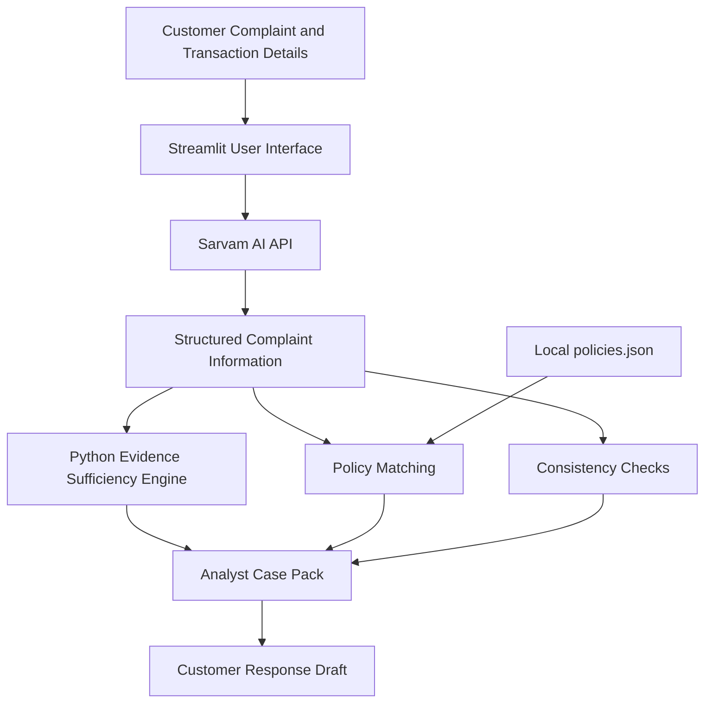

# DisputeLens — Multilingual Payment Dispute Intelligence & Evidence Copilot

**From customer complaint to evidence-backed dispute case.**

DisputeLens is an AI-powered payment dispute copilot built with **Streamlit, Python, and Sarvam AI**. It helps organize customer complaints in English, Hindi, and Hinglish into structured, explainable cases for payment-support analysts.

Instead of functioning as a basic chatbot, DisputeLens combines multilingual AI understanding with deterministic Python logic to identify missing evidence, match relevant demonstration policy rules, flag inconsistencies, and generate a review-ready dispute report.

> **Important:** DisputeLens is a decision-support tool only. It does not verify live transactions, approve refunds, reverse payments, or make official bank or regulatory decisions.

---

## Key Features

| Feature | Description |
|---|---|
| **Multilingual complaint understanding** | Accepts complaints in English, Hindi, and Hinglish and extracts relevant case information using Sarvam AI. |
| **Dispute classification** | Identifies likely categories such as failed payment, duplicate debit, unauthorized transaction, merchant dispute, and refund issues. |
| **Evidence Sufficiency Engine** | Calculates a transparent evidence-completeness score and identifies missing information using Python rules. |
| **Policy matching** | Matches complaints against a local JSON library of synthetic demonstration rules. |
| **Consistency checks** | Compares reported complaints with supplied transaction details and flags potential discrepancies. |
| **Recommended next steps** | Suggests information to collect, verification steps, or human review based on available evidence. |
| **Analyst case pack** | Organizes the summary, transaction details, policy evidence, missing information, inconsistencies, and recommended actions. |
| **Multilingual customer response** | Generates an empathetic draft response in the selected language. |
| **Demo mode** | Supports demonstration using predefined examples when a Sarvam API key is unavailable. |
| **Error handling** | Handles API failures, timeouts, missing credentials, empty responses, and malformed output where implemented. |

---

## How It Works

DisputeLens follows a five-stage workflow.

1. **Complaint intake:** The customer or analyst enters a complaint and any available transaction details.
2. **AI understanding:** Sarvam AI interprets the complaint, identifies the likely dispute category, and extracts reported facts.
3. **Evidence assessment:** Python evaluates the availability of required fields and calculates an evidence-completeness score.
4. **Policy matching and consistency checks:** The application searches the local policy library and compares the complaint with any supplied transaction information.
5. **Case report generation:** The results are organized into an analyst report with missing evidence, relevant policy examples, recommended next steps, and a draft customer response.

### System Architecture

**Architecture principle:** Sarvam AI handles language understanding and generation, while Python handles deterministic checks wherever possible. This reduces unnecessary API calls and makes the assessment more explainable.

---

## Evidence Sufficiency Engine

The Evidence Sufficiency Engine checks whether the information required for a particular dispute category has been supplied.

Depending on the case, relevant fields may include:

- Transaction reference or UTR
- Transaction amount
- Transaction date
- Payment status
- Merchant or recipient details
- Supporting transaction records, when available

The application calculates a score from 0 to 100 based on the evidence requirements and scoring rules implemented in the application.

The score represents **evidence completeness only**. It is not a fraud probability, a prediction of whether a refund will be approved, or the likelihood of winning a dispute.

The engine also displays the missing information so that an analyst can determine what to collect next.

---

## Policy Matching

DisputeLens uses a local `policies.json` file containing illustrative demonstration rules.

| Policy ID | Example category |
|---|---|
| `POL-001` | Failed payment with amount debited |
| `POL-002` | Duplicate or double debit |
| `POL-003` | Unauthorized transaction |
| `POL-004` | Missing UPI transaction reference |
| `POL-005` | Merchant service dispute |
| `POL-006` | Refund discrepancy |
| `POL-007` | Escalation for human review |
| `POL-008` | EMI or subscription charge dispute |

The application uses the matching logic implemented in the code to identify potentially relevant rules and display their IDs and supporting text.

**Policy disclaimer:** These rules are synthetic examples for demonstration purposes. They are not official policies of RBI, NPCI, any bank, Visa, Mastercard, or another financial institution. They must not be treated as authoritative regulatory or dispute-resolution guidance.

If no appropriate rule is found, the application should explicitly indicate that no supplied rule matched rather than inventing a policy citation.

---

## Consistency Checks

The consistency-checking component compares the complaint with transaction information supplied by the user.

Example scenarios include:

- A customer reports a failed payment, but the supplied transaction record shows success.
- A customer reports a duplicate debit, but only one transaction record is provided.
- The complaint amount differs from the supplied transaction amount.
- A transaction reference is missing or inconsistent.

Potential discrepancies are flagged for verification. Missing information alone does not establish fraud, and the application does not independently verify payment-system records.

---

## Analyst Case Pack

The final report brings the assessment together in a structured format:

1. Case summary
2. Dispute category
3. Reported transaction details
4. Evidence-completeness score
5. Available and missing evidence
6. Matched policy rule and supporting text
7. Consistency checks and potential contradictions
8. Recommended next steps
9. Suggested escalation status
10. Uncertainties and limitations
11. Draft customer response

The case pack is intended to help a support analyst review the complaint. The final investigation and financial decision remain with the responsible institution.

---

## Technology Stack

| Component | Technology |
|---|---|
| User interface | Streamlit |
| Language understanding and generation | Sarvam AI Chat Completion API |
| Backend logic | Python |
| HTTP requests | `requests` |
| Environment configuration | `python-dotenv` |
| Policy storage | Local JSON file |
| Evidence assessment | Deterministic Python rules |
| Consistency checks | Python field comparisons |

The MVP does not require a database, authentication system, vector database, model training, or live banking integration.

---

## Quick Start

### 1. Prerequisites

- Python 3.10 or later
- An internet connection for live Sarvam API requests
- A Sarvam API key supplied by the hackathon organizers

### 2. Open
